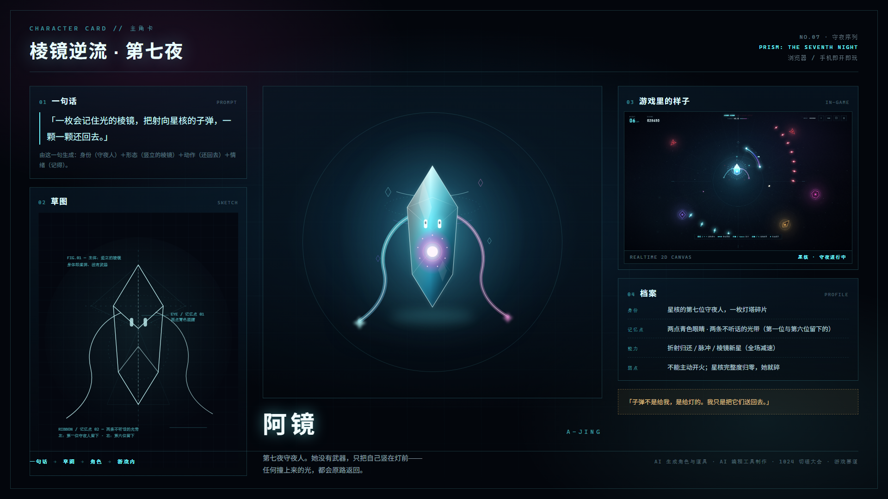
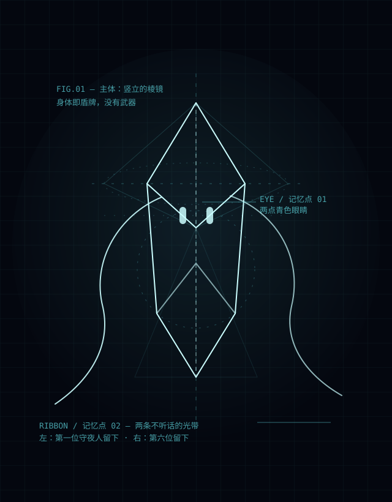
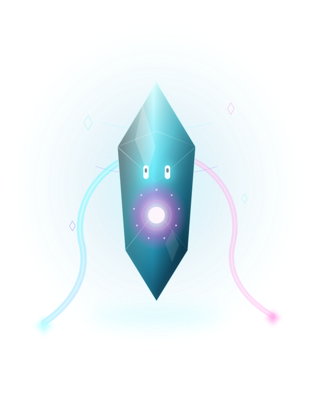
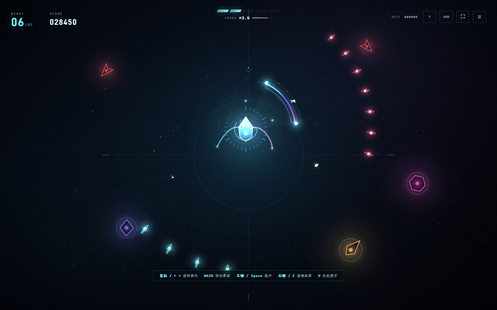

# 主角卡 · 阿镜 A-JING

> 1920×1080 版本：[`assets/character-card.png`](../assets/character-card.png) · 网页版：[`character-card.html`](character-card.html) · 游戏内：标题页「主角档案」

---

## 01 一句话（Prompt）

> **「一枚会记住光的棱镜，把射向星核的子弹，一颗一颗还回去。」**

拆开这句话，角色的四个要素就定了：

| 句子里的词 | 变成长什么样 |
| --- | --- |
| 一枚…棱镜 | 身体是一块竖立的六棱柱晶体，半透明，内部有棱线 |
| 会记住光 | 胸口有九点星火（七夜灯油计数），两条光带是前六位的残留 |
| 射向星核的子弹 | 她不主动攻击，只反弹；抛物线是她唯一的"攻击动作" |
| 一颗一颗还回去 | 弧面护盾是她的镜面；弹回去的子弹会追猎敌人 |

## 02 草图（AI 生成的概念线稿）

草图阶段只确定三件事：**轮廓**（竖立的棱镜）、**记忆点**（两点眼睛 + 两条光带）、**比例**（高约为宽的 2.4 倍，站立感）。

## 03 角色（AI 生成的角色立绘）

| 项 | 设定 |
| --- | --- |
| 名字 | 阿镜（A-JING） |
| 身份 | 星核的第七位守夜人，一枚灯塔碎片 |
| 序位 | NO.07 · 守夜序列 |
| 武器 | 没有。身体即盾，反弹即攻击 |
| 记忆点 | 两点青色眼睛；两条不听话的光带（左：第一位 / 右：第六位） |
| 能力 | 折射归还 / 脉冲 / 棱镜新星（全场减速） |
| 弱点 | 不能主动开火；星核完整度归零，她就碎 |
| 口头禅 | 「子弹不是给我，是给灯的。我只是把它们送回去。」 |

## 04 游戏里的样子

游戏内她只有约 50×60 像素，所以只保留三样东西：

1. **竖立的棱镜身躯**——一眼看出是"晶体"，而不是圆形飞行器；
2. **两点眼睛**——在 50 像素里仍然能被认出；
3. **两条光带 + 一颗粉色胸核**——拖尾方向随移动反向，让她"飞"起来。

实现见 `game.js` 的 `drawAjing()`（约 130 行 Canvas 2D，无外部贴图）。

---

## 附：生成与制作说明

- **角色 / 道具**：由 AI 生成概念 → 线稿 → 立绘（本仓库 `assets/*.svg`），再落到游戏内程序化渲染。
- **美术风格**：无图片素材，全部由 Canvas 2D（游戏内）与 SVG（立绘 / 卡片）绘制；配色统一为 `#6df7ff` 青 / `#ff58d8` 品红 / `#ffc46b` 琥珀。
- **主角卡排版**：`docs/character-card.html`，用无头 Chrome 以 1920×1080 导出 PNG，可随时重出。
